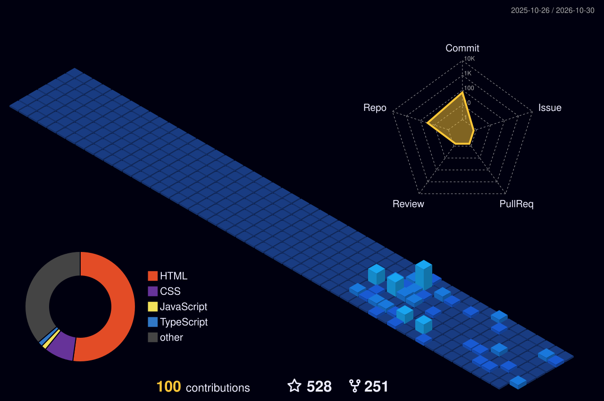



<!-- 🎬 HERO  video intro -->

  

 

<!-- 🍥 MY NINJA WAY -->

  

<!-- 🔦 JUTSU ARSENAL -->

  

<!-- 🪪 NINJA REGISTRATION + MISSION DASHBOARD -->

  

## 🍥 Featured Technical Focus

<table>
<tr><th>Area</th><th>What it is</th><th>Technologies</th></tr>
<tr><td><b>Audit &amp; Automation Workflows</b></td><td>Data extraction, rule-based validations, reconciliation &amp; consolidated reporting</td><td><code>React.js</code> <code>Node.js</code> <code>Excel &amp; PDF Pipelines</code></td></tr>
<tr><td><b>AI Copilot &amp; MCP</b></td><td>Contextual AI Copilot and Model Context Protocol server integrations</td><td><code>AI Copilot</code> <code>MCP Servers</code> <code>REST APIs</code></td></tr>
<tr><td><b>Database Performance</b></td><td>Constructed robust schemas with 30% faster data retrieval speeds</td><td><code>MySQL</code> <code>PostgreSQL</code> <code>SSMS</code></td></tr>
<tr><td><b>Full-Stack Web Applications</b></td><td>Component architectures, microservices, and high-concurrency systems</td><td><code>TypeScript</code> <code>JavaScript</code> <code>Java</code> <code>Laravel</code></td></tr>
</table>

<a href="https://github.com/Kritikraj920?tab=repositories"><b>→ See all repositories on GitHub</b></a>

  

### 🌃 My contribution village

*Every commit raises another building — rebuilt automatically every day.*

  

<!-- 💌 JOIN THE SQUAD -->

  

 

**Dattebayo — keep coding, keep growing.** 🍥

